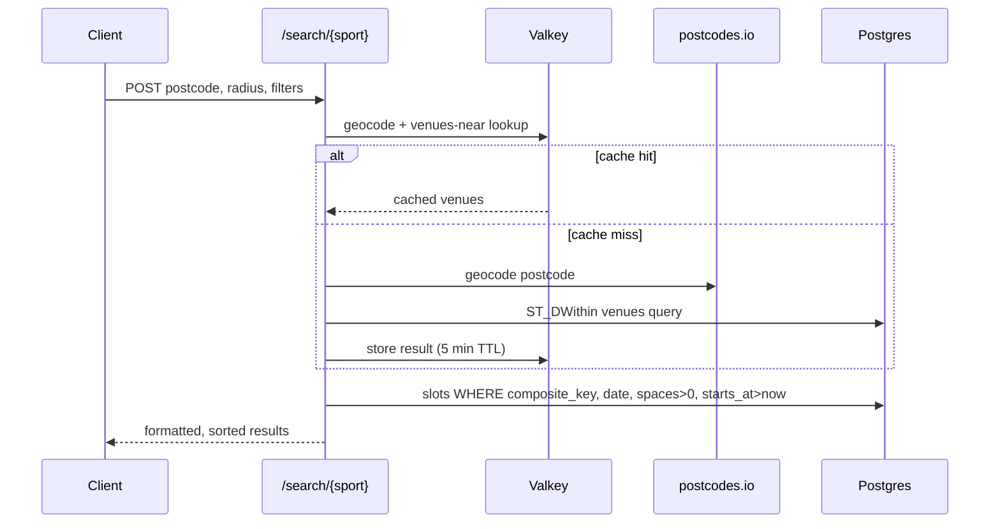

# API

FastAPI, deployed on Render. No `/api/v1/` prefix; routes are flat
(`/search/{sport}`, `/venues/near`, `/health/scrapers`).

## Search flow

`/search/{sport}` used to call its own `/venues/near` endpoint over HTTP to resolve
a postcode to nearby venues, an extra network hop to itself on every search request,
for data that barely changes minute to minute. It now calls the same underlying
function directly (`get_venues_near_postcode`), which `/venues/near` also calls; the
route and the internal call share one implementation.

## Insights

`/insights/*` (`api/routers/insights`, logic in `sportscanner/insights/`) serves
public market reports built from `slot_history`. Definitions live in
`insights/metrics.py` and are mirrored in the frontend methodology page
(`app-frontend/app/insights/methodology`): change both together.

- Occupancy = booked court-hours / offered court-hours, last 28 days, shown only
  once a venue has 20+ offered court-hours across 3+ days. Market occupancy pools
  measured venues only.
- Estimated booking value = booked court-hours x listed price per hour, as a
  28-day run-rate. Court hire only; not revenue.
- Peak = weekdays 07:00-09:00 and 17:00-22:00 plus all weekend hours (the same
  convention as other UK court market reports, so figures compare).
- Forward demand ("booked for the next 7 days") works from day one; the
  weekday x hour profile uses it until realised history covers 7 days.
- Boroughs come from postcodes.io bulk reverse geocoding (cached 24h);
  populations from `insights/data/london_borough_population.json` (ONS via Nomis,
  refresh yearly from the URL stored in the file).
- `/insights/planning` reads PlanIt's anonymous API (description keyword
  search). Without coordinates it searches the London authorities, matching the
  London market reports. With `latitude`, `longitude` and `radius` it resolves
  the planning authorities touching the radius through PlanIt's area endpoint
  and searches each register by name, so a site anywhere in the UK gets local
  applications. Results are deduplicated and cached for 12h per scope, serving
  the last good copy if PlanIt is down. A multi-council scope sets `partial`
  and `failed_authorities` when one register cannot be read.
- Venue rows also carry `address`, `website` (the booking platform's site), `min_price_per_hour`/`max_price_per_hour` (listed range), `avg_booked_price` (listed price of the hours actually booked) and `est_yearly_value` (28-day run-rate x 365/28, not seasonally adjusted); the summary carries market `est_yearly_value` and `avg_booked_price`. Heatmap cells include `booking_value` (average per occurrence) and `avg_price`.
- `/insights/planning` adds `top_agents`, `courts_by_setting`, `approved_courts_by_year`, and per application `documents_url`, `decided_by`, `agent` and `applicant`. Agent and applicant are only set when the register names an organisation (`_organisation()`); private individuals are dropped, never republished.
- Market and catchment reports include `opportunity`, a 0-100 heuristic for
  comparing areas, not a forecast. Four components are clamped to 0-100 and
  combined with fixed weights: supply gap (0.35) = 100 x (1 - courts per 100k
  / 10); demand (0.25) = 100 x share of the next 7 days already booked;
  occupancy headroom (0.20) = 100 x (1 - occupancy); price headroom (0.20) =
  100 x (1 - area median price / London median price). The score is the
  weighted mean rounded to an integer. If any input is missing, `score` is
  null, `components` is empty and `reason` names what is missing. The market
  basis is `{area} · all venues`; catchment uses `{radius} miles` and medians
  across nearby venues.
- Market and catchment reports include `capacity`, comparing observed public
  courts with a target of one court per 10,000 people (10 per 100k):
  `courts`, `target_courts`, `headroom_courts` (negative when observed supply
  exceeds target), `saturation_pct` and `target_basis`. Target fields are null
  when population is unknown.
- Market and venue reports include `metric_definitions` with the label and
  definition used by inline tooltips for `gbv`, `occupancy`, `revpah`,
  `gbv_per_court` and `courts_per_100k`.
- Venue rows carry `est_monthly_value_per_court` and its alias `gbv_per_court`
  (the same computation), plus `est_monthly_value`, `revpah`, `occupancy` and
  `courts`; catchment rows add `distance_miles`.
- Catchment demographics add `median_age`, `median_age_year`,
  `median_age_source`, `median_age_source_url`, `median_age_licence`,
  `median_income`, `mean_income`, `income_year`, `income_period`, `income_measure`,
  `income_definition`, `income_source`, `income_source_url`, `income_licence`
  and `income_note`. Median age is the population-weighted mean of ONS mid-2022
  LSOA medians. ONS small-area income estimates publish a modelled mean, not a
  median, so `median_income` is null and `mean_income` carries the sourced
  figure (FYE 2023, equivalised net before housing costs).
- Reports are cached in-process for 10 minutes and sent with
  `Cache-Control: public, max-age=300`.

### Local reports and history

- `GET /insights/{sport}?borough=hackney`: recomputes supply, pricing, demand and
  population metrics for a canonical London borough slug. Unknown boroughs 404.
- `GET /insights/{sport}/history?days=90&borough=hackney&venue=...`: optional borough
  and venue scope, a matched price index and daily observed supply. `days` is
  validated from 7 to 400. The response has a Pydantic contract in
  `api/routers/insights/schemas.py`.
- `GET /insights/{sport}/catchment?latitude=...&longitude=...&radius=3`: nearby
  competitors, local benchmarks and ONS England and Wales neighbourhood
  population/age estimates. Radius is in miles, from 0.5 to 20. Population uses
  2021 LSOA population-weighted centroids and mid-2024 estimates bundled with the
  package. Median age, mean income and the MHCLG English Indices of Deprivation
  2025 decile use the separate small-area reference in
  `insights/data/ew_lsoa_demographics.json`. The response groups residents by
  deprivation decile and by MSOA mean-income band, and carries the same figures
  for all of London in `demographics.london` for comparison. Each `areas` row also
  carries `mean_income` and `imd_decile` for map shading. Scottish and Northern
  Irish pins return no small areas and `demographics.coverage` says why.
  Refresh both references with
  `python -m sportscanner.insights.refresh_demographics`.
- `GET /insights/{sport}/constraints?latitude=...&longitude=...`: public government
  Planning Data point intersections for green belt, flood risk, conservation areas
  and Article 4 directions. England coverage; external failures return 503.
- Planning keyword searches support all five sports. Results can include
  alterations and removals, so court mentions are not a confirmed opening pipeline.

The report cache is bounded to 256 entries, including coordinate queries.

## Caching: Valkey

Postcode to lat/lng (via postcodes.io) and venues within a radius (a PostGIS query)
are both near-static: the same postcode and radius combination returns the same
answer for long stretches of time, but was being recomputed and re-queried on every
single search. Both are now cached in Valkey (Redis-protocol-compatible) with a
5-minute TTL.

Caching is best-effort by design: if `VALKEY_URL` is not configured, or the cache is
unreachable, every cache function degrades silently to a cache miss and the request
falls through to postcodes.io and Postgres as before. A cache outage never turns
into an API error.

## Security: parameterized queries

Two endpoints previously built SQL by interpolating request parameters directly
into the query string:

- `/health/scrapers?sports=` used the `sports` query parameter as a table name and
  as an array literal, both unescaped.
- `/venues/near` built a parameterized, correctly-escaped query, then discarded it
  and ran a second, unparameterized version instead.

Both are fixed. `sports` is validated against an allow-list of the four real table
names before it can reach the query string (a table name can never be a bound SQL
parameter, so an allow-list is the only option there); the `/venues/near` query now
uses the parameterized version, with a fixed column name matching the actual schema.
